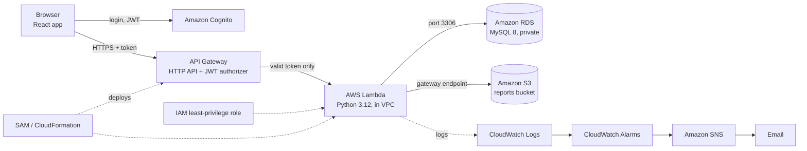

# Voyara

**A serverless travel planning and budget tracker built on AWS.**

   

## 🧭 What is Voyara?

Voyara lets a signed-in user plan trips, set a total and per-category budget, record expenses and build a day-by-day itinerary. It shows how much has been spent and warns when a budget is nearly used up (amber at 80%) or exceeded (red at 100%).

The project started as a browser-only React prototype that stored data in localStorage. It was moved to AWS so that each user has an account, the data is stored in a managed database, and the system is secured, monitored and deployable from code. The emphasis is on how the application uses AWS services.

## ✨ Key Features

1. **Accounts and login**: sign-up with an emailed verification code and login through Amazon Cognito. Passwords are never stored by the app.
2. **Trip planner**: create trips with origin, destination, dates, number of travellers and notes.
3. **Budget manager**: set a total budget and budgets for transportation, accommodation, meals, activities and miscellaneous. Add, view and delete expenses.
4. **Budget warnings**: an amber banner at 80% and a red banner at 100% of the budget. An optional SNS email alert can be switched on per trip with the alerts checkbox (see Known Limitations).
5. **Itinerary**: plan activities per day with times and planned costs, and compare planned against actual spending.
6. **Charts and dashboard**: spending by category (doughnut chart), planned versus actual (bar chart), and totals across all trips.
7. **Reports**: export a trip as CSV or PDF. The file is stored in a private S3 bucket and downloaded through a link that expires after 5 minutes.
8. **Admin analytics**: members of the Cognito group `admins` see aggregate figures such as total users, trips, top destinations and trips per month. The API enforces this, not just the UI.
9. **Per-user isolation**: every query is filtered by the signed-in user. Another user's trip returns 404.

## 🏗️ System Architecture



The browser logs in with Cognito and sends the resulting token with every API call. API Gateway validates the token before invoking Lambda, so a request without a valid token gets a 401 and never reaches the code. Lambda runs inside the VPC of the database. The RDS security group accepts port 3306 only from the Lambda security group, and the database is not publicly accessible. Reports reach S3 through a free gateway endpoint, so no NAT Gateway is needed. Lambda logs go to CloudWatch, and alarms on Lambda errors and API 5xx responses notify an SNS topic that emails the team. The whole backend is defined in one SAM template.

A larger drawing is in [`docs/architecture.svg`](docs/architecture.svg).

## 🧰 Tech Stack

| Technology | Role |
|---|---|
| React 19, react-router 7, Chart.js | Single-page frontend and charts |
| amazon-cognito-identity-js | Sign-up, login and token handling in the browser |
| Amazon Cognito | User accounts, email verification, `admins` group |
| Amazon API Gateway (HTTP API) | Public HTTPS entry point, JWT authorizer, throttling, CORS |
| AWS Lambda (Python 3.12, arm64) | Application logic and a database migration function |
| PyMySQL | MySQL access from Lambda |
| Amazon RDS for MySQL 8 | Relational database |
| Amazon VPC, security groups, S3 gateway endpoint | Network isolation and private access to S3 |
| Amazon S3 | Private encrypted bucket for CSV and PDF reports (30-day expiry) |
| Amazon CloudWatch | Logs (7-day retention) and alarms |
| Amazon SNS | Alarm and alert emails |
| AWS IAM | Least-privilege role for the Lambda |
| AWS SAM / CloudFormation | Infrastructure as code |
| pytest, Jest | Backend and frontend tests |

## 📁 Project Structure

```
voyara/
├── frontend/    React app (Create React App)
├── backend/     Lambda source (src/) and tests (tests/)
├── database/    Versioned SQL migrations, optional seed data, app-user template
├── infra/       SAM/CloudFormation template
├── scripts/     setup_aws.sh, one-shot deployment script
├── reporting/   Optional CLI/EC2 report script
└── docs/        Deployment, API, testing and cost guides, architecture diagram
```

## 🗄️ Dataset

There is no external dataset. Data is created by users and stored in MySQL (tables: `users`, `trips`, `budgets`, `expenses`, `itineraries`, `itinerary_activities`). Optional fake seed data is in `database/seed/`. One large demo video used by the Learn More page is kept out of Git; see [DATA_README.md](DATA_README.md) for how to supply it.

## 🔧 Implementation Highlights

- **Authentication**: API Gateway validates the Cognito JWT (issuer and audience). The Lambda reads identity only from the verified claims, never from the request body.
- **CORS preflight**: the `OPTIONS` route is deliberately unauthenticated, because browsers cannot send a token on a preflight request.
- **Private database**: RDS is not publicly accessible. A separate migrate Lambda running inside the VPC creates the schema and a low-privilege application user that can read and write but not drop tables.
- **Budget logic**: server-side maths uses `Decimal` and `DECIMAL(12,2)` columns. Status is `ok`, `warning` (at least 80%) or `exceeded` (at least 100%).
- **Reports**: built in memory, stored under `reports/<user>/<trip>/` with server-side encryption, and CSV cells that start with `=`, `+`, `-` or `@` are neutralised against formula injection.
- **Observability**: every request writes one JSON log line with method, path, status and duration.
- **Tests**: `docs/TESTING.md` records 67 backend tests and 23 frontend tests passing, plus a clean production build.

## 🚀 Quick Start Guide

### Prerequisites

- An AWS account and an IAM user (not root), configured with `aws configure --profile voyara`
- AWS CLI v2 and AWS SAM CLI
- Node.js 20, Python 3.12 and Git Bash (or another bash)
- An existing Amazon RDS MySQL instance in `ap-south-1`. The setup script reads its settings and does not create it.

### Steps

1. Clone the repository.

   ```bash
   git clone https://github.com/kvlokeshkumar/voyara.git
   cd voyara
   ```

2. Deploy the backend. The script asks for your RDS master user and password and your email, then creates the network pieces, Cognito and the SAM stack, runs the database migration and writes `frontend/.env.local`.

   ```bash
   export AWS_PROFILE=voyara
   bash scripts/setup_aws.sh
   ```

   To configure the frontend by hand instead, copy the example file and fill in the three values:

   ```bash
   cp frontend/.env.example frontend/.env.local
   ```

3. Add the demo video (see [DATA_README.md](DATA_README.md)). The Learn More page imports `frontend/src/assets/screenrecord.mp4`, and the build fails without it.

4. Install and start the frontend.

   ```bash
   cd frontend
   npm install
   npm start
   ```

   The app opens at **http://localhost:3000**. The RDS instance must be running.

5. Sign up, enter the emailed code and log in. To become an administrator, add your user to the `admins` group in the Cognito console and log in again.

### Run the tests

```bash
cd backend
python -m venv .venv && source .venv/bin/activate
pip install -r requirements-dev.txt
docker run -d --name voyara-mysql -p 3306:3306 -e MYSQL_ROOT_PASSWORD=localdev mysql:8.0
TEST_DB_PASSWORD=localdev pytest -v

cd ../frontend
CI=true npm test -- --watchAll=false
```

## 🧪 Usage / Sample Inputs

| Where | Try | Expected result |
|---|---|---|
| Planner | Chennai to Bali, 10 to 14 Dec 2026, 2 travellers, budget 50000 | Trip is created and listed on the Dashboard |
| Budget | Add expense: meals, "Welcome dinner", 3500.50 | Spent and percent used update; no banner below 80% |
| Budget | Add expenses until spending reaches 80% of the total | Amber warning banner |
| Budget | Add expenses until spending reaches 100% | Red banner |
| Budget | Click the CSV or PDF export | A file downloads; the object appears in the reports bucket |
| Terminal | `curl -i <ApiUrl>/trips` | `HTTP 401 Unauthorized` |
| Second account | Open the first account's `?tripId=` URL | "Trip not found" |

Request and response examples for every route are in [docs/API.md](docs/API.md).

## 📚 Documentation

- [PROJECT_KNOWLEDGE.txt](PROJECT_KNOWLEDGE.txt): full end-to-end project details
- [DATA_README.md](DATA_README.md): seed data and the file kept out of Git
- [docs/DEPLOYMENT.md](docs/DEPLOYMENT.md): step-by-step AWS deployment
- [docs/API.md](docs/API.md): API reference
- [docs/TESTING.md](docs/TESTING.md): test results and the cloud test checklist
- [docs/COST_AND_CLEANUP.md](docs/COST_AND_CLEANUP.md): cost control and cleanup checklist
- [docs/DEMO_SCRIPT.md](docs/DEMO_SCRIPT.md): five-minute demo script

## ⚠️ Known Limitations and Future Work

- Spending-alert emails from the Lambda are skipped: the function is in a VPC without a NAT Gateway or SNS endpoint. On-screen warnings and CloudWatch alarm emails still work.
- Database credentials are stored as encrypted Lambda environment variables rather than in Secrets Manager, to avoid its endpoint cost.
- RDS is single-AZ.
- The CloudFront distribution and website bucket are described in `docs/DEPLOYMENT.md` but are not part of the SAM template.
- One Lambda serves all routes, so IAM permissions apply per function rather than per route.
- Possible next steps: Secrets Manager or Parameter Store, Multi-AZ, X-Ray tracing, WAF, a CI/CD pipeline, and an S3-triggered Lambda outside the VPC to send alert emails.
